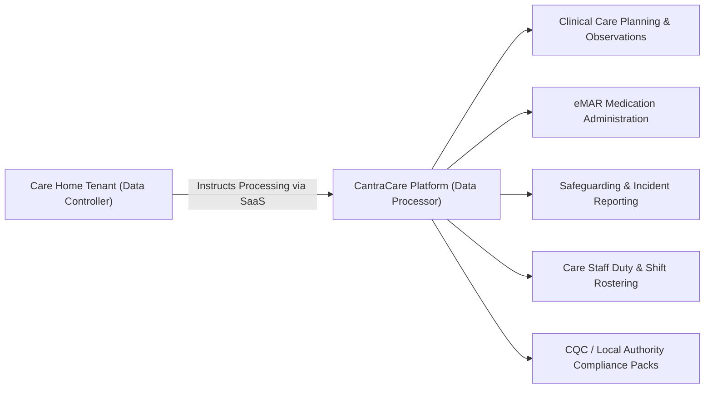

# CantraCare — Statutory Record of Processing Activities (ROPA)

**Document Reference**: ROPA-UKGDPR-A03  
**Statutory Basis**: UK General Data Protection Regulation (UK GDPR) Article 30; Data Protection Act 2018 (DPA 2018); Health and Social Care Act 2008 (Regulated Activities) Regulations 2014: Regulation 17.  
**Classification**: Statutory Governance Record / Audited Annually  
**Effective Date**: November 2026  
**Last Updated**: November 2026

---

## PART 1: RECORD OF PROCESSING ACTIVITIES AS CONTROLLER (UK GDPR Art. 30(1))

*Applicable to CantraCare Technologies Ltd.'s direct internal operations, customer administration, and platform security.*

### 1. Controller & Governance Contacts
- **Controller Name**: CantraCare Technologies Ltd.
- **Registered Office**: 100 Bishopsgate, London, EC2N 4AG, United Kingdom
- **Company Registration**: 14289102 (England & Wales)
- **Data Protection Officer (DPO)**: `dpo@cantracare.com` | Tel: +44 (0)20 7946 0199
- **ICO Registration Number**: ZB894102 (Tier 2/3 Data Controller)

---

### 2. Controller Processing Inventory

| Processing Activity ID | Business Purpose | Categories of Individuals | Categories of Personal Data | Lawful Basis (Art. 6) | Special Category / Criminal (Art. 9 / Sch. 1) | Retention Period | Security Measures (TOMs) |
|---|---|---|---|---|---|---|---|
| **CTRL-01** | Tenant Commercial & Contract Administration | Tenant Executives, Care Home Directors | Name, business email, business telephone, corporate bank billing details, tenancy contract tier | Art. 6(1)(b) Contract performance | N/A | 7 years post-contract termination (Limitation Act 1980 / HMRC) | TLS 1.3 in transit, AES-256 encrypted database, RBAC |
| **CTRL-02** | Platform Authentication & Credential Management | Tenant Authorized Users (Admins, Managers, Nurses, Carers) | Work email, password hash (bcrypt salt 12), MFA TOTP secret (AES-256 encrypted), user status | Art. 6(1)(b) Contract, Art. 6(1)(f) Account security | N/A | Maintained while user account active; purged 90 days after deactivation | Bcrypt work factor 12, encrypted at rest, 15m JWT auto-expiry |
| **CTRL-03** | System Integrity & Security Event Logging | All platform users & visitors | IP address, user-agent string, endpoint accessed, authentication timestamp, failure reason, device fingerprint | Art. 6(1)(f) Legitimate interests (cybersecurity defense) | N/A | 12 months rolling; immutable append-only storage | SHA-256 hash chaining, separate audit database schema, no write-after-insert |
| **CTRL-04** | Statutory Compliance & Inquiries (ICO, CQC, MHRA) | Legal complainants, regulatory officers | Name, professional title, correspondence history, notice records, legal advice | Art. 6(1)(c) Legal obligation | N/A | 6 years post-matter resolution | Encrypted storage, restricted to DPO and Legal Counsel |

---

## PART 2: RECORD OF PROCESSING ACTIVITIES AS PROCESSOR (UK GDPR Art. 30(2))

*Applicable to all Resident and Tenant Staff Care Home Operational Data processed on behalf of Care Home Tenants.*

### 1. Categories of Processing Carried Out on Behalf of Controllers

---

### 2. Detailed Processor Inventory (By Module)

#### 2.1 Resident Clinical Management & Care Planning (`PROC-01`)
- **Controller**: Care Home Tenant (Registered Care Provider).
- **Categories of Data Subjects**: Care home residents (past, current, prospective).
- **Categories of Personal Data**: Full name, preferred name, date of birth, gender, room/bed assignment, next of kin contacts, GP and NHS clinical contacts.
- **Special Category Data (Art. 9(2)(h))**:
  - NHS Number (Strictly AES-256-GCM encrypted with tenant key).
  - Medical diagnoses, allergies (drug, food, environmental).
  - Daily care plans, mobility assessments, nutritional & fluid intake.
  - Body map wound findings (pressure ulcer stage 1-4, dimensions in mm, exudate level).
  - Vital signs observations (NEWS2 score, blood pressure, SpO2, heart rate, respiration).
  - Resuscitation orders (DNACPR / ReSPECT status, LPA health & welfare, Court Deputyship).
- **Lawful Basis Determined by Controller**: UK GDPR Art. 6(1)(c) (Legal Obligation — Health and Social Care Act 2008 Reg 17), Art. 6(1)(d) (Vital Interests), Art. 9(2)(h) (Health & Social Care Treatment).
- **Retention Schedule**: 8 years from date of discharge or death (Records Management Code of Practice for Health and Social Care 2021). Configurable by Tenant Retention Policy (`TenantRetentionPolicy.adultCareRecordsYears`).
- **Transfers to Third Countries**: None. All primary and secondary replica databases reside exclusively in the UK (`eu-west-2` London).

#### 2.2 Electronic Medication Administration Records (eMAR) (`PROC-02`)
- **Controller**: Care Home Tenant.
- **Categories of Data Subjects**: Residents, Prescribing Doctors, Administering Carers/Nurses, Secondary Witnesses.
- **Categories of Personal Data**: Drug name, dosage, route/form, administration schedule, carer ID and digital signature, witness name/role/signature, refusal reason, omission reason, adverse reaction logs.
- **Special Category Data**: Full pharmacotherapy and controlled drug records (Misuse of Drugs Act 1971 / NICE Guideline SC1).
- **Specific Retention**: Minimum 8 years post-discharge; Controlled Drug Register entries retained for minimum 11 years (NICE SC1 Recommendation 1.8.4).
- **Integrity Controls**: Clinical rectification strike-through workflow (`isSuperseded: true`, `correctionReason`, `correctedAt`, `correctedById`). Zero hard deletes allowed.

#### 2.3 Safeguarding & Serious Incident Register (`PROC-03`)
- **Controller**: Care Home Tenant.
- **Categories of Data Subjects**: Residents, alleged perpetrators, whistleblowers, investigating staff.
- **Categories of Personal Data**: Care Act 2014 s.42 referral details, CQC Regulation 13 notification records, Police crime references, Local Authority case officer contact, immediate protection plan.
- **Retention**: Minimum 10 years from case closure (configurable up to 30 years for serious adult safeguarding investigations).

#### 2.4 Staff Duty Rostering & Safer Recruitment Compliance (`PROC-04`)
- **Controller**: Care Home Tenant.
- **Categories of Data Subjects**: Care home staff, nurses, agency personnel.
- **Categories of Personal Data**: Full name, contact phone, residential address, emergency contacts, hourly rate, contracted hours, assigned shift history.
- **Criminal Offence Data (DPA 2018 Sch. 1 Pt. 1)**: DBS certificate number, issue date, barred list status (Adult/Child), Right to Work verification, immunisation status (Hep B, Covid-19, Flu).
- **Retention**: 6 years post-termination of employment (Limitation Act 1980 / CQC Reg 19).

---

## 3. Technical and Organisational Security Measures (TOMs)

Pursuant to UK GDPR Article 32, CantraCare enforces the following technical and organizational safeguards across all processing:

1. **Pseudonymisation & Encryption**:
   - Data at Rest: PostgreSQL tables encrypted via AWS KMS AES-256. Column-level encryption applied to high-sensitivity identifiers (NHS Number, resident DOB, user phone number, DBS certificates) using AES-256-GCM.
   - Data in Transit: TLS 1.3 enforced for all external HTTPS traffic and internal microservices. Deprecation of TLS 1.0/1.1.
2. **Access Control & Tenant Isolation**:
   - Logical isolation at database layer enforcing `tenantId` filtering extracted directly from validated JWT signatures (`req.user.tenantId`).
   - Caldicott Guardian / Need-to-Know branch scoping preventing cross-branch visibility for non-management care staff.
   - 15-minute idle inactivity auto-logout on web and mobile interfaces.
3. **Resilience & Continuity**:
   - Automated nightly encrypted backups with geographic UK multi-AZ redundancy.
   - Automated disaster recovery restore verification scripts (`ops/backup/verify-restore.sh`).
   - One-click Emergency Handover & MAR PDF generator (`GET /api/emergency-directory/:id/print-pack`) enabling offline continuity during network or infrastructure failure.
4. **Auditability**:
   - Immutable audit logging of every read, write, modification, export, and delete operation, hashed and stored in dedicated schema.

---

## 4. Annual Review & Custodianship

- **Document Owner**: Head of Information Governance & Data Protection Officer.
- **Next Mandatory Review**: November 2027 (or immediately upon introduction of new modules or international transfers).

