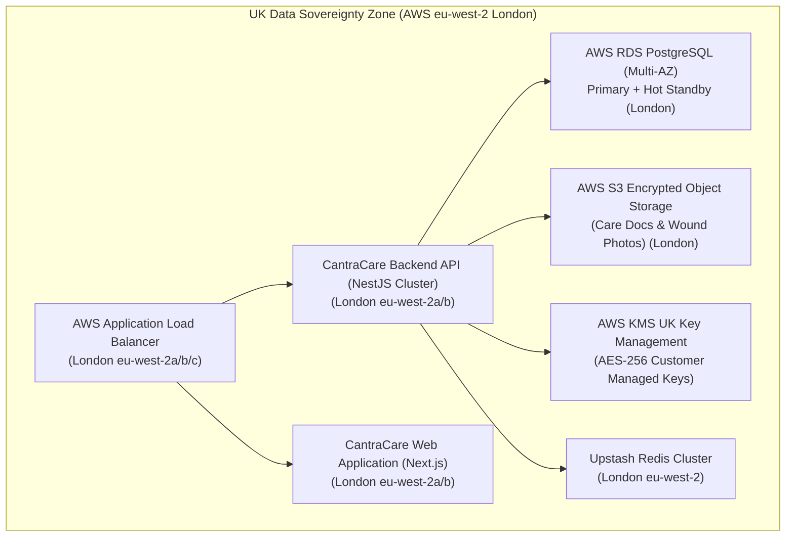

# CantraCare — Hosting Infrastructure & UK Data Residency Certification

**Document Reference**: HOST-REG-H01  
**Statutory Basis**: UK General Data Protection Regulation (UK GDPR) Chapter V (Articles 44–49); Data Protection Act 2018; Health and Social Care Act 2008 (Regulated Activities) Regulations 2014; NHS Data Security and Protection Toolkit (DSPT) Standard 9.  
**Classification**: Public Compliance & Regulatory Assurance Document  
**Effective Date**: November 2026

---

## 1. Statutory Statement of UK Data Sovereignty

CantraCare Technologies Ltd. formally certifies that all **Personal Confidential Data (PCD)**, **Special Category Health Data (Article 9)**, resident medical records, eMAR charts, wound photographs, and operational care home records processed within the CantraCare multi-tenant SaaS application are stored, processed, and backed up **strictly within the territorial boundaries of the United Kingdom**.

Zero identifiable resident clinical records are transferred to or hosted within data centers located outside the United Kingdom.

---

## 2. Infrastructure Inventory & Geographic Mapping

---

## 3. Component Details & Region Specifications

| Infrastructure Layer | Service Provider & Product | AWS Region / Facility | Physical Location | Data Contained | Encryption Standard |
|---|---|---|---|---|---|
| **Primary Relational Database** | AWS RDS for PostgreSQL 16 (Multi-AZ) | `eu-west-2` (London) | Slough / London, UK | All core entities: Residents, Care Plans, Observations, eMAR, Shifts, Users, Audit Logs | AWS KMS AES-256 at rest + Application-level AES-256-GCM |
| **Document & Media Object Storage** | AWS S3 Standard (SSE-KMS) | `eu-west-2` (London) | Slough / London, UK | Admission contracts, Power of Attorney orders, Body map photos, Compliance PDFs | AWS KMS SSE-KMS Customer Managed Key (AES-256) |
| **Application & API Compute** | AWS ECS / EC2 Cluster | `eu-west-2` (London) | London, UK | Stateless runtime application logic, memory buffers | Volatile memory only; encrypted root EBS volumes |
| **Distributed Caching & Throttling** | Upstash Redis | `eu-west-2` (London) | London, UK | IP rate limiting counters, session tokens, task queues | In-memory with TLS in transit, AES-256 persistence |
| **Key Management Service** | AWS KMS | `eu-west-2` (London) | London, UK | Master encryption keys, application cryptographic secrets | FIPS 140-2 Level 3 validated HSMs |
| **Disaster Recovery Secondary Replicas** | AWS RDS Read Replica / Encrypted Snapshots | `eu-west-2` (London, Alternate AZ) | Alternate London Availability Zone | Full secondary snapshot database for automated failover | Encrypted with same regional KMS master key |

---

## 4. International Data Transfer Safeguards (Chapter V)

### 4.1 Strict Policy of Non-Transfer
CantraCare does not utilize "offshore" support teams, overseas remote DBA contractors, or non-UK sub-processors for any core application functionality that touches resident clinical records or identifiable data.

### 4.2 Ancillary Support Services (Non-Clinical)
1. **Error Tracking & Performance Telemetry**:
   - System error monitoring tools (e.g., Sentry) are configured strictly with **Zero-PII scrubbing**.
   - IP addresses, resident names, NHS numbers, and authentication cookies are redacted before any network payload leaves the browser or server runtime.
2. **Third-Party Telephony / Push Notifications**:
   - Outbound notifications (SMS via Twilio, Push via FCM) utilize strict pseudonymization (`C-09`). Payloads contain zero full names or clinical diagnoses. All communications with these services are governed by valid UK International Data Transfer Addendums (IDTA) and Binding Corporate Rules (BCRs).

---

## 5. CQC, NHS DSPT, & Caldicott Assurance

This UK Data Residency architecture fully satisfies:
- **NHS National Data Guardian (NDG) Standard 9**: Protecting systems against external cyber threats and ensuring data sovereignty.
- **CQC Regulation 17(2)(c)**: Maintaining securely stored, complete, and readily accessible records of each service user.
- **Caldicott Principle 7**: The duty to share information for individual care is as important as the duty to protect patient confidentiality within lawful UK boundaries.

---

## 6. Verification and Attestation

This architecture is verified annually via independent penetration testing and NHS DSPT submission. For compliance inquiries, contact `security@cantracare.com` or `dpo@cantracare.com`.

